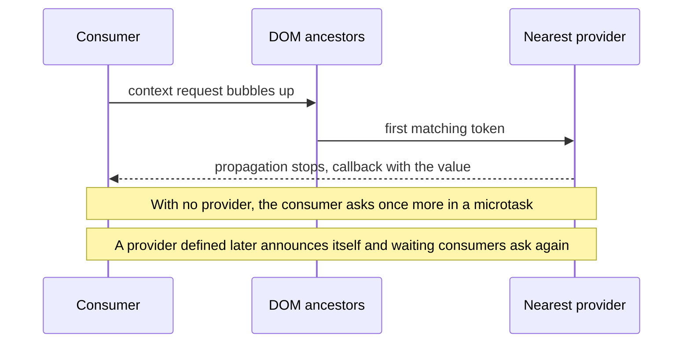

# Context

Context is the Radiant mechanism for sharing data across component boundaries without manually threading props through every intermediate host.

It is based on the [community protocols proposal](https://github.com/webcomponents-cg/community-protocols/blob/main/proposals/context.md).

## Creating A Context

Use `createContext(...)` to create a typed token. The key (typically a `Symbol`) is the runtime identity used for matching providers to consumers. The generic parameter carries the value type at the TypeScript level. At runtime `createContext` is zero-cost — the returned token is just the key itself.

```typescript
import { createContext } from '@ecopages/radiant/context';

export const myContext = createContext<{ value: string }>(Symbol('my-context'));
```

Use a unique `Symbol` for each token to avoid accidental collisions between unrelated contexts.

## The Four Main APIs

- [@provideContext](/docs/context/provide-context) attaches a provider to a host.
- [@consumeContext](/docs/context/consume-context) injects the nearest matching provider onto a field.
- [@contextSelector](/docs/context/context-selector) binds a field to the whole context or a selected slice. Rerenders the host automatically on change.
- [@onContextUpdate](/docs/context/on-context-update) runs a method when the context changes. Use this for imperative side effects.

## How Context Resolution Works

Context resolution uses two different transport mechanisms depending on the environment.

### Client (DOM Events)

On the client, context flows through the DOM tree using custom events with `bubbles: true` and `composed: true`, so they cross shadow DOM boundaries.

1. A **provider** listens on its host element for incoming context request events.
2. A **consumer** dispatches a request that bubbles up through the DOM. `@consumeContext` uses an internal Radiant request that returns the provider instance. `@contextSelector` and `@onContextUpdate` dispatch a `ContextSubscriptionRequestEvent`, and when no Radiant provider answers they send the same request as a protocol `context-request`, so a provider from another library can answer it.
3. The nearest ancestor provider whose token matches stops the event's immediate propagation, then calls the callback with the value (or the selected value). A plain `context-request` (`ContextRequestEvent`) is answered as the protocol specifies: see [Manual alternative](/docs/context/consume-context#manual-alternative).
4. A consumer that finds no provider asks once more in a microtask, so a provider that upgrades right after it still answers.
5. A consumer that is still unanswered waits. When a provider is created, as its element upgrades, it announces itself once with a bubbling, composed `context-provider` event that carries the `context` and the `contextTarget` (the same late-provider event Lit's `@lit/context` uses; it is not part of the protocol itself, which defines only `context-request`; a provider that only reconnects does not announce again, because consumers ask again when they connect), and every waiting consumer below it asks again, for both plain and subscribing requests. A consumer that disconnects stops waiting, and a request is answered once. Definition order therefore does not matter: a provider defined by a lazy import still reaches consumers that were already in the document, and they keep receiving updates.



Because resolution relies on event bubbling, the provider must be a DOM ancestor of the consumer. Sibling or detached elements cannot resolve each other's context.

### SSR (Ambient Provider Stack)

During server-side rendering there is no DOM tree to bubble events through. Instead, Radiant stores an ambient provider stack as symbol-keyed state on the JSX SSR render scope (`AsyncLocalStorage` via `@ecopages/jsx/server`).

1. `renderComponent(...)` pushes any `ssrContext` providers and the component's own providers onto the stack.
2. Consumer decorators resolve the token by walking the stack innermost-to-outermost — mirroring the nearest-ancestor semantics of DOM bubbling.
3. After rendering, the stack frame is popped in a `finally` block.

Providers that set the `hydrate` option emit a `<script type="application/json">` tag into the rendered markup. On the client, the provider parses that tag and merges the payload into `initialValue`, restoring server state before the first render.

## Typical Shape

Use context when several related components need shared state such as theme, auth state, carts, todo lists, or service objects.