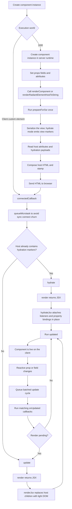

# Radiant Core

Reflected properties serialize the current member state on each write. A reflected attribute change is not fed back into the property: setting a string property to `''`, or an array transform to a value that omits the attribute, keeps the assigned property value. A synchronous callback (`@bindTo`, `registerUpdateCallback`) that normalizes an assignment is reflected too. `@onUpdated` does not run at that moment; it waits for the update cycle.

## RadiantElement Flow

`RadiantElement` is the JSX-first custom-element base for explicit client rendering and opt-in hydration. Host HTML serialization belongs to the **server pipeline** (`@ecopages/radiant/server/*`), not to instance methods on the element.

Its main responsibilities are:

- `connectedCallback()` decides whether first connect should hydrate or do a fresh client render.
- `update()` explicitly flushes callbacks and commits a pending render.
- `hydrate()` is the explicit SSR-to-client entrypoint.
- `renderViewToString()` is the narrow host hook that asks the installed server runtime to serialize the JSX view (requires a server SSR entry import).



## Client Flow

Client rendering works like this:

1. The browser upgrades the custom element and calls `connectedCallback()`.
2. The first connect reads the `data-radiant-ssr` stamp into `isServerRendered` and removes the attribute. `RadiantElement` then waits one microtask, then `completeInitialSync()` adopts authored attributes and reflects the values the host actually holds. A property assigned before upgrade, or through its accessor before that sync, wins over the authored attribute.
3. If the host is server-rendered or already contains hydration markers, and the explicit client hydrator is installed, `hydrate()` attaches behavior to that DOM in place. A render-owning host in that view is adopted, not rebuilt: the parent binds only that element's own attributes, properties and events, and assigns its children value, and the nested host then hydrates its own view with the parent's JSX in it. In hydrate mode the server stamps such a host `data-radiant-ssr="children"`, and with the hydrator installed it stays inert until that value arrives: it has no event bindings, runs no `@onUpdated` callbacks, first `@bindTo` flush, `onConnected()` or `updated()`, and render requests wait (a write to a `@bindTo` field still reaches its target). When the parent's module imports the nested host, the nested host's tag is defined first and it connects first, so its whole first connect sync, hydration included, runs when the parent assigns the value during its own hydration. When the parent's tag is defined first, the value arrives before the nested host's first-connect microtask, which then hydrates as usual. A nested host whose parent never renders on the client stays inert server markup, and its `onConnected()` never runs.
4. Otherwise `update()` renders fresh light DOM into the host.
5. Later reactive changes schedule matching `@onUpdated` callbacks. A render commits when code requests it or a tracked render dependency invalidates the view.

Writes in the same turn share one update cycle. `@onUpdated` runs once for each batch of watched members; if a callback changes one of them, it can run again in the same cycle. A pending render commits, then `updated(changed)` runs. `await updateComplete` waits for that cycle, including the first connect render.

On every client connect, after the update or hydration and post-sync callbacks, the Element Host flushes connect-only callbacks before `onConnected()`. `createResource(...)` uses this client-only phase, so authored prop values are ready before its first fetch and server serialization never starts it.

Hosts observe their members only while connected, snapshotting values on disconnect and reporting what changed on the next connect. Automatic updates run for connected hosts in any DOM. Server rendering never connects hosts: it observes members only while preparing a host, drains pending `@onUpdated` callbacks, and never calls `updated()`. A cycle that throws drops pending member changes and render requests, then rejects `updateComplete`; a later write starts a new cycle. This also stops a self-updater that reaches the 100-round limit.

Decorators and SSR adapters reach host plumbing (post-sync, connect-sync and batched callback registration, the SSR provider and hydration registry, initial update emits) through the `REACTIVE_HOST` symbol, not through public host methods.

`render()` describes the view. `update()` runs the cycle that commits it into the host.

## Children and Slots

`<slot>` in `render()` resolves against one of two sources, held by the host's render runtime:

- **Children Value.** `RadiantElement` answers `@ecopages/jsx`'s `CUSTOM_ELEMENT_CHILDREN_SYMBOL` protocol with `true` when the class overrides `render()`, so a view that creates the element hands it a **Children Value** instead of mounting those children inside it, and passes the value again on every view render. `<slot />` resolves to that value, or to its fallback when the value is empty; named slots resolve to their fallback. The host's renderer is the only one that touches the resulting nodes. A JSX child marked `slot="name"` stays in the default slot, and nodes appended to the host remain outside the projected slot content; both warn in development builds.
- **Authored Children.** Any other render-owning host captures its direct children once, at first render, or reads them from the SSR slot-projection payload (written for a host the server renders outside every view, or nested in a view in plain mode), and assigns them by `slot` attribute. A `childList` observer projects nodes appended later. Children that a view rendered before the tag was defined land here, with a development warning.

A host the server rendered with **Authored Children** that fill a named slot (stamped `data-radiant-ssr="authored"`, as for such a host outside every host's view) keeps them for its lifetime: it ignores any **Children Value**, so its named slots stay as the server rendered them when page-level JSX hydrates over it. A host whose Authored Children only fill its default slot takes the value, which renders them in the same place with live bindings. The page's hydration keeps the host's node when the tag was defined before the page JSX was created; otherwise, or when the page JSX hydrates while the tag is still undefined, the page JSX put the children inside the element and the host is rebuilt, taking them as Authored Children, as before. A page JSX with no binding of its own can also reconnect after a nested host has hydrated or rendered itself, even if it updated since, provided the page's static markup still matches; otherwise it renders fresh.

`getSlotElements(...)` and `@querySlot(...)` read the default slot's top-level rendered elements for a **Children Value**, and the assigned nodes for **Authored Children**.

## SSR Flow

SSR works like this:

1. Server code creates the component instance (typically via `renderComponent(...)`).
2. Server code sets props, fields, or attributes exactly as client code would.
3. When authored light DOM is needed, a server render environment applies it through `prepareHost` / `authoredContent` before serialization.
4. Prefer `@ecopages/radiant/server/render-component` for adapters and fragment responses.
5. Each host serialization runs `prepareForSsr` once, renders the view, then reads attributes and hydration payloads from that state.
6. When hydration is requested, the view may include hydration markers and the host tag is stamped with `data-radiant-ssr`.
7. The browser receives `<my-element ...>...</my-element>` markup.
8. On first connect, the same component instance logic decides whether to hydrate or do a fresh render.

Radiant renders into the host's light DOM only, on the client and on the server.

`renderRadiantElementViewToString(...)` / `renderViewToString()` serialize only the component view.
`renderRadiantElementHostToString(...)` from `@ecopages/radiant/server/radiant-element-ssr` / `renderComponent(...)` serialize the full custom-element host together with the view.
When slot-aware SSR needs authored light DOM, adapters prepare the host through `prepareHost` / `authoredContent` on `renderComponent`.

## Public API

- `render()` returns the current JSX tree.
- `update()` runs the update cycle now and rerenders the host from the current JSX tree when `render()` is overridden.
- `hydrate()` hydrates SSR markup already present in the host.
- `isServerRendered` is `true` when the instance was first connected from markup that hydrate-mode SSR produced. Hosts that adopt server-rendered content check it instead of `hasHydrationMarkers`.
- `renderViewToString()` asks the installed server runtime to serialize the view (server entry must be imported first).

Host attribute serialization and full host HTML composition live in the server pipeline. They are not Element Host instance APIs.

For first-connect hydration on SSR pages, install the explicit client hydrator before loading component modules:

```ts
import '@ecopages/radiant/client/install-hydrator';
```

## Host Attributes

By default, server host serialization includes:

- reflected reactive properties from `getReactiveProperties()`
- reactive property metadata registered through `@prop(...)`
- attributes already present on the element instance

Reactive prop metadata is stored per constructor. Subclass `@prop` registrations copy inherited definitions before writing, so sibling and parent classes keep class-specific registries and SSR host attributes.

See [../server/README.md](../server/README.md) for adapter-facing SSR helpers.
