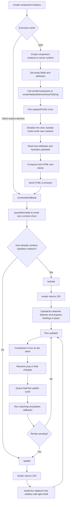
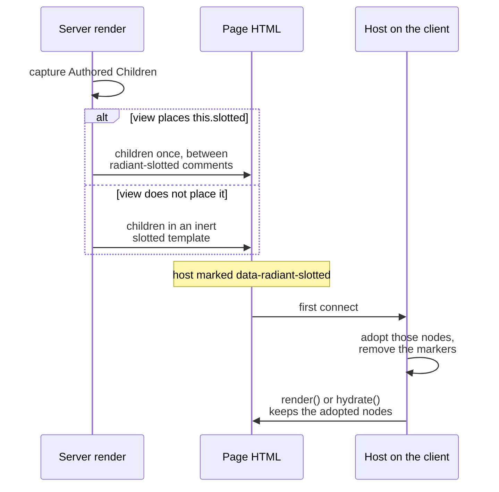

# Radiant Core

Reactive members expose JSX bindings through `this.$`, `this.bindings`, and `this.bind(...)` on each host instance. Element and Controller Hosts share the same tracked-render implementation.
In development, `render-warnings.ts` attributes each re-render to the fields that changed since the last one and that the previous `render()` read through their accessors, and warns once per class and field when such a field also has a `this.$` Binding subscribed or re-ran the render 30 times within a second. `ReactiveHost` creates it behind the `process.env.NODE_ENV` guard; `RadiantElement` (through `RenderRuntime`) and `RadiantController` pass `reactiveHost.renderWarnings` on to their `TrackedRender`. A production build drops it.
A member needs only `get` and `subscribe` (`ReadonlyReactiveState`): `registerReactiveMember` accepts such a read-only source and `this.$`, `@onUpdated`, `@bindTo` and SSR preparation work on it. `ReactiveState` adds `set` for `@prop`, `@state`, `@attr` and `@signal`. `getReactiveMember` returns the registered member typed read-only (the same object, not a wrapper), so write through the host field. Declaring one of those decorators or `createReactiveField` on a name already held by a read-only member throws, and so does registering a read-only member over a name that already has a field accessor; replacing a member that has none keeps working.
Member access on a binding follows `createStore(...)` path writes and replacement of the host member. A plain object member updates nested bindings when the member is replaced.

Reflected properties serialize the current member state on each write. A reflected attribute change is not fed back into the property: setting a string property to `''`, or an array transform to a value that omits the attribute, keeps the assigned property value. On a connected host, a synchronous callback (`@bindTo`, `registerUpdateCallback`) that normalizes an assignment is reflected too. `@onUpdated` does not run at that moment; it waits for the update cycle.

## RadiantElement Flow

`RadiantElement` is the JSX-first custom-element base for explicit client rendering and opt-in hydration. Host HTML serialization belongs to the **server pipeline** (`@ecopages/radiant/server/*`), not to instance methods on the element.

Its main responsibilities are:

- `connectedCallback()` decides whether first connect should hydrate or do a fresh client render.
- `update()` explicitly flushes callbacks and commits a pending render.
- `hydrate()` is the explicit SSR-to-client entrypoint.
- Server code serializes a view with `renderRadiantElementViewToString(...)` from `@ecopages/radiant/server/radiant-element-ssr`.



## Client Flow

Client rendering works like this:

1. The browser upgrades the custom element and calls `connectedCallback()`.
2. The first connect reads the `data-radiant-ssr` stamp into `isServerRendered` and removes the attribute. `RadiantElement` then waits one microtask, then `completeInitialSync()` adopts authored attributes and reflects the values the host actually holds. A property assigned before upgrade, or through its accessor before that sync, wins over the authored attribute.
3. If the host is server-rendered or already contains hydration markers, and the explicit client hydrator is installed, `hydrate()` attaches behavior to that DOM in place. A render-owning host in that view is adopted, not rebuilt: the parent binds only that element's own attributes, properties and events, and assigns its children value, and the nested host then hydrates its own view with the parent's JSX in it. In hydrate mode the server stamps such a host `data-radiant-ssr="children"`, and with the hydrator installed it stays inert until that value arrives: it has no event bindings, runs no `@onUpdated` callbacks, first `@bindTo` flush, `onConnected()` or `updated()`, and render requests wait (a write to a `@bindTo` field still reaches its target). When the parent's module imports the nested host, the nested host's tag is defined first and it connects first, so its whole first connect sync, hydration included, runs when the parent assigns the value during its own hydration. When the parent's tag is defined first, the value arrives before the nested host's first-connect microtask, which then hydrates as usual. A nested host whose parent never renders on the client stays inert server markup, and its `onConnected()` never runs.
4. Otherwise `update()` renders fresh light DOM into the host.
5. Later reactive changes schedule matching `@onUpdated` callbacks. A render commits when code requests it or a tracked render dependency invalidates the view.

Writes in the same turn share one update cycle. `@onUpdated` runs once for each batch of watched members; if a callback changes one of them, it can run again in the same cycle. A pending render commits, then `updated(changed)` runs. `await updateComplete` waits for that cycle, including the first connect render.

On every client connect, after the update or hydration and post-sync callbacks, the Element Host flushes connect-only callbacks before `onConnected()`. `createResource(...)` uses this client-only phase, so authored prop values are ready before its first fetch and server serialization never starts it.

Hosts observe their members only while connected, snapshotting values on disconnect and reporting what changed on the next connect. Synchronous update callbacks (`@bindTo`, `registerUpdateCallback`) subscribe and release with that observation, and run on connect for members that changed while detached. A member replaced while detached is compared with its value at disconnect; before the first connect, a replacement is the member's initial value. Initial emits (`createReactiveField`, the first-connect emit of `@prop` members) run update callbacks only while observed, so the first connect paints `@bindTo` once.

The connect pass is single-owner. A connection callback registered through `registerConnectedCallback` (decorator connect work) that disconnects the host ends the pass, leaving no subscription behind and skipping the host's connect work: the Controller Host's update cycle, or the Element Host's deferred connect sync. One that also reconnects it leaves the nested connect as the only pass, so that work runs once. The connect diff subscribes every update callback first, then visits members in registration order: a write during it to a visited member runs that member's callbacks like any write, and a write to an unvisited one waits for its own diff. A callback that disconnects the host stops the rest of that member's pass, an unregistered one is skipped, and the stop function `observeMembers()` returns ends only the observation it started.

A prop starts from the first of: a write after construction, a value the host held (an authored attribute, a property assigned before upgrade, or on a Controller Host a property of the host element), the `defaultValue`, the field initializer when there is no `defaultValue`. A write wins even when it equals the default or the prop has no `defaultValue`, and first connect reports it once and reports nothing for props that were not written. When an initializer and a `defaultValue` differ the `defaultValue` wins and development builds warn (`warnInitializerWithDefaultValue`), under both decorator modes. Under the legacy decorators the initializer is told apart from a write by setup at the end of the most derived constructor: `@customElement` and `@controller` wrap the class for that (`withLegacyConstructionEnd`), so a Controller Host follows the same rules as an Element Host. A legacy Controller Host class without `@controller`, including one passed to `registerController` directly, is set up at first connect instead (`ensureLegacyControllerReady`): there an initializer and a write are both an own value, and any defined own value is taken as the author's, winning over the host's value and the `defaultValue`.

Controller Host `@prop` and `createReactiveField` adopt a member the legacy decorators bootstrapped at construction instead of replacing it, so a binding taken earlier keeps following the field. A `@signal` (with its `hydrate` option) or `@provideContext` hydrates under a Controller Host from its `id:field` script like an Element Host's, and a controller without an identifier uses the bare field name.

Automatic updates run for connected hosts in any DOM. Server rendering never connects hosts: it observes members only while preparing a host, drains pending `@onUpdated` callbacks, and never calls `updated()`. A cycle that throws drops pending member changes and render requests, then rejects `updateComplete`; a later write starts a new cycle. This also stops a self-updater that reaches the 100-round limit.

Decorators and SSR adapters reach host plumbing (post-sync, connect-sync and batched callback registration, the SSR provider and hydration registry, initial update emits) through the `REACTIVE_HOST` symbol, not through public host methods.

`render()` describes the view. `update()` runs the cycle that commits it into the host.

## Children and Slotted Content

`render()` places the host's children with `{this.slotted}`, or `{this.slotted ?? fallback}`: `slotted` is `null` when there are none. `<slot>` is an ordinary element. The host's render runtime holds the content from one of two sources:

- **Children Value.** `RadiantElement` answers `@ecopages/jsx`'s `CUSTOM_ELEMENT_CHILDREN_SYMBOL` protocol with `true` when the class overrides `render()`, so a view that creates the element hands it a **Children Value** instead of mounting those children inside it, and passes the value again on every view render. The host's renderer is the only one that touches the resulting nodes. Named regions are properties: `<x-card header={<h2 />}>` rendered with `{this.header}`.
- **Authored Children.** Any other render-owning host captures its direct children once, before its first render, or adopts the slotted content the server rendered for it (for a host the server renders outside every view, or nested in a view in plain mode): the nodes between the `<!--radiant-slotted-->` comments where the view placed them, which stay in place, or the content of a `<template data-radiant-slotted>` when the view did not place them. Only a host the server marked with `data-radiant-slotted` looks for them. Nodes appended later are not slotted. Children that a view rendered before the tag was defined land here, with a development warning.



Capture runs before every render until it succeeds, so a host whose view places `slotted` only later still holds what it had at first render. A view that passes a Children Value replaces captured content, and server slotted content the host has not adopted yet is dropped: its comments, template and attribute are removed.

When page-level JSX hydrates over a host the server rendered with Authored Children, the host takes the page's Children Value, which renders the same children in the same place with live bindings. The page's hydration keeps the host's node when the tag was defined before the page JSX was created; otherwise, or when the page JSX hydrates while the tag is still undefined, the page JSX put the children inside the element and the host is rebuilt, taking them as Authored Children. A page JSX with no binding of its own can also reconnect after a nested host has hydrated or rendered itself, even if it updated since, provided the page's static markup still matches; otherwise it renders fresh.

While connected, `slotted` comes wrapped in two empty text nodes, so place it once per render. `slottedElements` reads the top-level elements between them; it is empty before the first client render and on the server.

## Part Scope

A part is a node named with `data-ref`. It belongs to the nearest enclosing scope root: an upgraded Element Host, or the root element of a Controller Host while its controller is attached. `src/core/parts.ts` holds the rule, and `@ref`, `@refAll`, `getRef` on both hosts, `@onEvent({ ref })` and `@bindTo({ ref })` all resolve through it, so an outer host never gets the same-named part of a nested host.

- A part that is itself a nested host belongs to the host around it: `<rui-slider data-ref="seek">` is the outer host's `seek`.
- Ownership is read from the current DOM on every read, with no cache. A nested Element Host starts a scope only once it has upgraded; before that its subtree belongs to the outer host. `RadiantController.connect()` starts a Controller Host scope and `disconnect()` ends it.
- Third-party custom elements and catalog controllers (`createXController`) do not start a scope.
- `@refAll` and `getRef(name, true)` leave out nested hosts' parts and return document order. `@onEvent({ ref })` matches by containment: it walks up from the event target to the host, skips a same-named part another host owns, and fires for the nearest one the host owns. A click on a nested host's part reaches the outer handler only when it happened inside an outer part of that name, so a container part such as `root` or `trigger` still hears events from nested hosts that reuse the name.
- `@query(selector)` and `@queryAll(selector)` are not scoped: they are the explicit way into a nested host.
- The part name is escaped inside a quoted attribute selector (`\` and `"`), and the server DOM shim decodes those escapes, so any name resolves the same in the browser and on the server.
- `@onEvent({ ref })` does not fire for a `data-ref` on the host element itself: the host is never its own part.

## SSR Flow

SSR works like this:

1. Server code creates the component instance (typically via `renderComponent(...)`).
2. Server code sets props, fields, or attributes exactly as client code would.
3. When authored light DOM is needed, a server render environment applies it through `prepareHost` / `authoredContent` before serialization.
4. Prefer `@ecopages/radiant/server/render-component` for adapters and fragment responses.
5. Each host serialization runs `prepareForSsr` once, renders the view, then reads attributes and hydration payloads from that state.
6. When hydration is requested, the view may include hydration markers and the host tag is stamped with `data-radiant-ssr`.
7. The browser receives `<my-element ...>...</my-element>` markup.
8. On first connect, the same component instance logic decides whether to hydrate or do a fresh render.

Radiant renders into the host's light DOM only, on the client and on the server.

`renderRadiantElementViewToString(...)` serializes only the component view. It prepares the host, enters its context providers, and flushes `@bindTo` once after rendering, like the full host serializer.
`renderRadiantElementHostToString(...)` from `@ecopages/radiant/server/radiant-element-ssr` / `renderComponent(...)` serialize the full custom-element host together with the view.
When SSR needs authored light DOM, adapters prepare the host through `prepareHost` / `authoredContent` on `renderComponent`.

## Public API

- `render()` returns the current JSX tree.
- `update()` runs the update cycle now and rerenders the host from the current JSX tree when `render()` is overridden.
- `hydrate()` hydrates SSR markup already present in the host.
- `isServerRendered` is `true` when the instance was first connected from markup that hydrate-mode SSR produced. Hosts that adopt server-rendered content check it instead of `hasHydrationMarkers`.
- `renderRadiantElementViewToString(...)` from `@ecopages/radiant/server/radiant-element-ssr` serializes the view without the host tag.

Host attribute serialization and full host HTML composition live in the server pipeline. They are not Element Host instance APIs.

For first-connect hydration on SSR pages, install the explicit client hydrator before loading component modules:

```ts
import '@ecopages/radiant/client/install-hydrator';
```

## Host Attributes

By default, server host serialization includes:

- reflected reactive properties from `getReactiveProperties()`
- reactive property metadata registered through `@prop(...)`
- attributes already present on the element instance

A `@prop` declared with `attribute: false` is property-only and is skipped by both attribute sources: it is not observed, reflected or serialized.

Reactive prop metadata is stored per constructor. Subclass `@prop` registrations copy inherited definitions before writing, so sibling and parent classes keep class-specific registries and SSR host attributes.

See [../server/README.md](../server/README.md) for adapter-facing SSR helpers.
